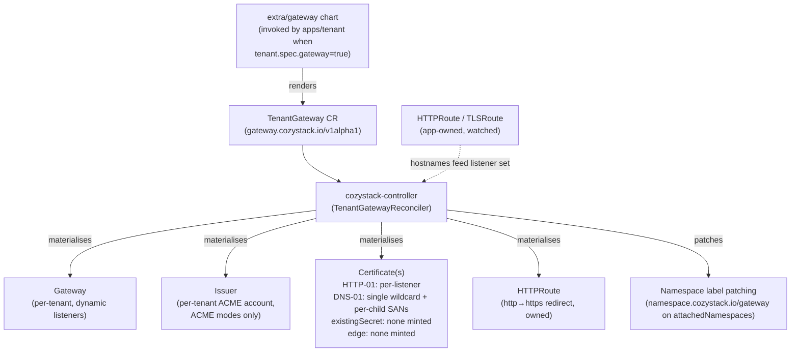
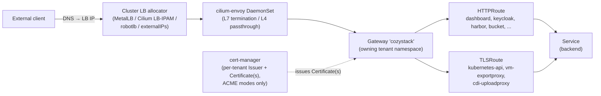
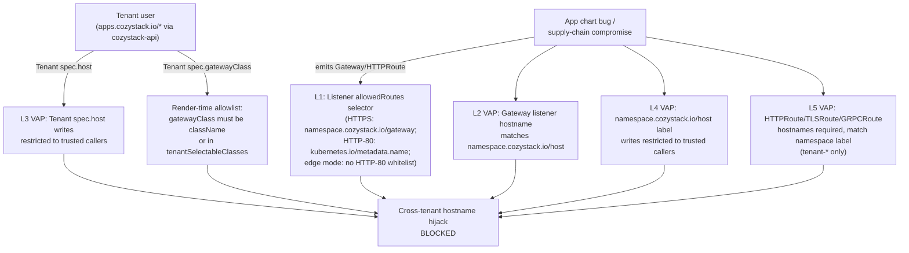

## Обзор

Cozystack ships Gateway API support as an opt-in alternative to ingress-nginx. When enabled, a tenant that explicitly opts in via `tenant.spec.gateway: true` gets its own `Gateway` materialised in its own namespace — on the bundled Cilium class that means its own LoadBalancer Service and LB IP, and on the ACME cert modes its own per-tenant Issuer and Certificate. A class whose provider publishes the Gateway some other way, such as an outbound tunnel, may render neither. Every other tenant in the tree publishes through the Gateway of the nearest ancestor that owns one — same shape as the existing `_namespace.ingress` inheritance.

Чарт не рендерит ресурсы `Gateway`, `Issuer` или `Certificate` напрямую. Вместо этого он рендерит один CR `gateway.cozystack.io/v1alpha1 TenantGateway` на каждый включивший опцию тенант, а `cozystack-controller` согласует из него все нижестоящие объекты Gateway API и cert-manager. Это устраняет гонку между Helm и контроллером за `Gateway.spec.listeners`, которую иначе вызывала бы динамическая материализация слушателей на основе маршрутов.

This page documents the architecture, the inheritance model, the choice of GatewayClass, the cert-mode choice (HTTP-01 default, DNS-01 wildcard opt-in, an operator-provided wildcard Secret, or TLS terminated at the class provider's edge), the two-group security model, and the migration story from ingress-nginx.

Gateway API и ingress-nginx сосуществуют в одном кластере - режимы выбираются для каждого сервиса / тенанта, а не глобально. Существующие кластеры обновляются с `gateway.enabled=false` и не видят изменений в поведении.

### Поверхность API для тенантов

Тенанты в Cozystack взаимодействуют с платформой исключительно через ресурсы `apps.cozystack.io/*`, обслуживаемые `cozystack-api`; RBAC тенанта не даёт права записи в `gateway.networking.k8s.io/*`, базовые `Namespaces` или `cozystack.io/Package`. В разделе [Безопасность](#безопасность) объясняется, как уровни допуска (admission) выстроены с учётом этого ограничения.

## Архитектура

### Поток согласования



Контроллер:

- Materialises the `Gateway`, the redirect HTTPRoute, and — on the ACME cert modes — the per-tenant `Issuer` and the Certificate(s) from `TenantGateway.spec`. In `existingSecret` mode it mints neither, and points the listeners at the operator-supplied Secret instead. In `edge` mode it renders no redirect HTTPRoute either, and deletes one it previously owned.
- Watches `HTTPRoute` and `TLSRoute` resources cluster-wide. For each hostname an `HTTPRoute` attached to its Gateway claims, it (in HTTP-01 mode) appends a per-app HTTPS listener + a per-app `Certificate`, unless a TLS-passthrough listener answers that hostname. A hostname that only a `TLSRoute` claims earns neither: its backend presents its own certificate.
- In DNS-01 mode, extends the wildcard `Certificate` with `<child-apex>` + `*.<child-apex>` SANs for every tenant inheriting through this Gateway (discovered by listing namespaces with `namespace.cozystack.io/gateway = <owner>` and reading their `namespace.cozystack.io/host`), and adds one `*.<child-apex>` HTTPS listener per inheriting child.
- Patches `namespace.cozystack.io/gateway = <owner>` onto every namespace in `TenantGateway.spec.attachedNamespaces` (the cozy-* system namespaces published through the Gateway). The patch is annotated with `cozystack.io/gateway-attached-by` so the controller knows which labels it wrote and which are owned by the `apps/tenant` chart — labels written by the chart are never touched. Labels written by the controller are garbage-collected when the namespace is removed from `attachedNamespaces`.
- In HTTP-01 mode, resolves cross-namespace hostname conflicts: `cozy-*` namespaces (cluster-admin-managed platform services) win over tenant namespaces; the loser receives a `HostnameConflict` condition under the controller's name in `Status.Parents`. The other modes gather no claims, so nothing is resolved and no route condition is written.
- Отказывается молча присваивать уже существующие объекты `Gateway`, `Issuer`, `Certificate` или HTTPRoute перенаправления, которые носят выведенное контроллером имя, но не несут `OwnerReference` на TenantGateway. Операторы видят явное условие `Ready=False/ReconcileError` вместо перезаписи их вручную закреплённой конфигурации.

### Путь трафика



- **`GatewayClass`** is set per TenantGateway, and which class a tenant Gateway may land on is bounded by the platform. `gateway.className` (default `cilium`) is the class used unless the tenant names another; a tenant names one with `tenant.spec.gatewayClass`, and may only name the current default or something `gateway.tenantSelectableClasses` allows, which is empty by default. The class also decides whether the Gateway terminates TLS itself or leaves it to the class provider — see [Enabling Gateway API](#enabling-gateway-api) for the values and [edge](#edge-tls-terminated-by-the-class-provider) for the latter case.
- **One `Gateway` per owning tenant** in that tenant's namespace. Every inheriting child's HTTPRoutes / TLSRoutes attach to the same Gateway via cross-namespace ParentRef; there is no cross-Gateway merge.
- **Envoy** runs as a Cilium DaemonSet (`cilium.envoy.enabled=true`) and handles both TLS termination (HTTPS listeners) and TLS passthrough (dedicated per-service listeners for the kubeapiserver and the KubeVirt VM export / CDI upload proxies). `envoy.enabled=true` is the default for fresh Cozystack installations; operators upgrading an existing cluster where the Cilium values were set explicitly should verify the flag is on before flipping `gateway.enabled`.
- **LoadBalancer IP** — on a class whose dataplane wants an inbound address, which the bundled Cilium class does — is allocated by whichever LB mechanism the cluster admin has configured at the platform layer, same shape as ingress-nginx today. A class that reaches the cluster over an outbound connection asks for no address at all. Cozystack ships MetalLB installed but does not render any `IPAddressPool` / `L2Advertisement` / `BGPAdvertisement` / `CiliumLoadBalancerIPPool` from the tenant chart. Admins wire up the allocator that fits their environment (MetalLB pool with L2 / BGP, Cilium LB-IPAM with announcer, [robotlb](https://github.com/aenix-io/robotlb) against a Hetzner Robot fleet, or `Service.spec.externalIPs` as a manual pinning mechanism). The tenant API stays mechanism-agnostic — there is no `gatewayIP` field on the Tenant CR. To pin a specific address, the operator pre-creates the LoadBalancer Service with `loadBalancerIP` set, or hands the tenant a reference to a named admin-managed pool.
- **`externalTrafficPolicy`**: the LoadBalancer Service that backs the Gateway is created by Cilium and uses the Kubernetes default (`Cluster`). Source IPs of external clients are therefore NAT'd to the receiving node. The legacy ingress-nginx path behaves the same way whenever `publishing.externalIPs` is set — the usual bare-metal install — because the host ingress Service is then a `ClusterIP` carrying `spec.externalIPs` with `externalTrafficPolicy: Cluster`. It preserves source IPs only when `publishing.externalIPs` is left empty: the Service is a `LoadBalancer` with `externalTrafficPolicy: Local`, which constrains the LB IP to nodes hosting ingress pods. Operators who need source IP preservation for Gateway-API traffic must patch the Service themselves or front it with a PROXY-protocol-capable upstream LB.

### Раскладка слушателей на Gateway тенанта

On every cert mode except [edge](#edge-tls-terminated-by-the-class-provider), a tenant Gateway materialises an HTTP listener:

| # | Имя | Протокол | Порт | Имя хоста | Назначение |
| --- | --- | --- | --- | --- | --- |
| 1 | `http` | `HTTP` | 80 | none (wildcard) | ACME `/.well-known/acme-challenge/*` + HTTP→HTTPS redirect HTTPRoute — the redirect renders on every cert mode that has this listener, which is all of them except [edge](#edge-tls-terminated-by-the-class-provider); the ACME challenge path is only used on the ACME modes |

Плюс HTTPS-слушатели, зависящие от режима сертификатов:

- **HTTP-01 mode (default):** one HTTPS listener per hostname an attached `HTTPRoute` claims, named `https-<first-label>-<8-hex>`. A hostname a TLS-passthrough listener answers is reserved to that listener and gets no HTTPS listener (see [TLS passthrough](#tlsroute-tls-passthrough)), and a hostname that only a `TLSRoute` claims gets none either. Every other claimed hostname gets exactly one listener and one certificate, owned by the route that wins it; a route that loses a cross-namespace race is marked `Accepted=False` by [conflict resolution](#hostnameconflict-resolution) rather than rejected, and the hostname itself is still served. The hex suffix is the first 32 bits of `sha256` over the **lower-cased** hostname, so two different hostnames sharing the same first label (`harbor.foo.example.com` vs `harbor.alice.example.com`) get distinct listener names. Each listener's `tls.certificateRefs` points at a per-listener `Certificate` named `<tgw>-<first-label>-<8-hex>-tls`, also auto-issued.
- **Режим DNS-01 (по выбору):** слушатели `https` (`*.<owner apex>`) и `https-apex` (`<owner apex>`), использующие единственный wildcard-Certificate, плюс по одному слушателю `https-child-<first-label>-<8-hex>` на apex каждого наследующего потомка (со ссылкой на тот же wildcard-сертификат, чьи dnsNames расширены SAN-записями `<child-apex>` + `*.<child-apex>`).
- **Режим existingSecret (wildcard, предоставленный оператором):** тот же набор слушателей, что и в DNS-01, - `https` (`*.<owner apex>`), `https-apex` (`<owner apex>`) и по одному `https-child-<first-label>-<8-hex>` на apex каждого наследующего потомка, - за исключением того, что каждый `tls.certificateRefs` указывает на предоставленный оператором Secret с именем из `publishing.certificates.wildcardSecretName`, и ни для одного из них `Certificate` не выпускается.
- **[edge mode](#edge-tls-terminated-by-the-class-provider):** no HTTPS listeners at all. The Gateway serves port 80 only, with `edge` (`*.<owner apex>`), `edge-apex` (`<owner apex>`) and one `edge-child-<first-label>-<8-hex>` per inheriting child apex, and neither the hostname-less `http` listener above nor any passthrough listener is rendered.

Plus, on every mode except edge, one extra listener per TLS-passthrough service on the publishing tenant (see [TLS passthrough](#tlsroute-tls-passthrough)) and one per entry in the `TenantGateway`'s `tlsPassthroughListeners` (see [TLS passthrough on native ports](#tls-passthrough-on-native-ports)).

`allowedRoutes.namespaces` слушателей использует два разных селектора в зависимости от роли слушателя:

- **HTTPS and TLS-passthrough listeners — and, in [edge](#edge-tls-terminated-by-the-class-provider) mode, the port-80 `edge*` listeners that stand in for them** — match the `namespace.cozystack.io/gateway` label and admit routes from any namespace whose label equals the owner tenant's namespace name (e.g. `tenant-root`, `tenant-alice` — the namespace name, not the bare tenant name). This is the inheritance hinge — every inheriting child's namespace carries the same label value (written by the `apps/tenant` chart), and cozy-* system namespaces in `attachedNamespaces` get the same label patched on by the controller.
- **The plain-HTTP listener (port 80)** uses a strictly narrower whitelist on the built-in `kubernetes.io/metadata.name` label — only the owner tenant's namespace itself (where the controller-owned redirect HTTPRoute lives) and `cozy-cert-manager` (HTTP-01 ACME challenge HTTPRoutes). App HTTPRoutes attaching to the Gateway by hostname therefore cannot bind to port 80 and serve plaintext. This listener, and with it that guarantee, exists only on the non-edge modes: an [edge](#edge-tls-terminated-by-the-class-provider) Gateway has no hostname-less port-80 listener, and the port-80 listeners it does render carry the wide selector, so app routes bind them by design.

Port-443 listeners pin `allowedRoutes.kinds` to `HTTPRoute` and `TLSRoute` (the pair is listed on each of them so that Cilium keeps the listeners apart), so `GRPCRoute`, `TCPRoute` and `UDPRoute` cannot attach to them. The port-80 listener leaves `allowedRoutes.kinds` unset, which for an HTTP listener admits `GRPCRoute` as well, so the route-hostname VAP covers `GRPCRoute` too (Layer 5 under [Security](#security)).

## Включение Gateway API

Gateway API is opt-in at two levels, and they are independent rather than sequential: `gateway.enabled` moves the platform's own published services onto Gateway API, while `tenant.spec.gateway` materialises a tenant's own Gateway. Either can be set without the other. Both defaults stay `false`; upgrades do not flip tenants silently.

### 1. Флаг на уровне платформы

Установите `gateway.enabled: true` в Package `cozystack.cozystack-platform`. Полные таблицы значений `gateway.*` и `publishing.certificates.dns01.*` см. в [справочнике Platform Package]({}).

```yaml
apiVersion: cozystack.io/v1alpha1
kind: Package
metadata:
  name: cozystack.cozystack-platform
spec:
  variant: isp-full
  components:
    platform:
      values:
        publishing:
          host: example.org
        gateway:
          enabled: true
          attachedNamespaces:
            - cozy-cert-manager
            - cozy-dashboard
            - cozy-keycloak
            - cozy-system
            - cozy-harbor
            - cozy-bucket
            - cozy-kubevirt
            - cozy-kubevirt-cdi
            - cozy-monitoring
            - cozy-linstor-gui
            - default
```

Пространство имён `default` включено потому, что `TLSRoute` Kubernetes API (поставляемый пакетом cozystack-api) живёт рядом с сервисом `kubernetes`, на который он указывает, а тот всегда находится в `default`.

Включение `gateway.enabled=true` задействует три вещи:

- `ClusterIssuer.spec.acme.solvers` в cert-manager переключается с `http01.ingress.ingressClassName` на `http01.gatewayHTTPRoute`, прикрепляющийся к Gateway публикующего тенанта.
- Шаблоны публикуемых сервисов (dashboard, keycloak, grafana, alerta) перестают рендерить свой `Ingress` и начинают рендерить свой `HTTPRoute`.
- Сервисы со сквозной передачей TLS (cozystack-api, vm-exportproxy, cdi-uploadproxy) перестают рендерить свой `Ingress` и начинают рендерить `TLSRoute`, прикреплённый к выделенному слушателю Passthrough.

Список `attachedNamespaces` перечисляет системные пространства имён `cozy-*`, маршруты которых должны публиковаться через Gateway тенанта-владельца. Контроллер проставляет `namespace.cozystack.io/gateway = <owner>` на каждую запись, чтобы её маршруты проходили селектор `allowedRoutes` слушателя. Пространства имён тенантов (`tenant-*`) тоже могут быть в списке - они просто получают ту же метку наряду с записями `cozy-*`. Статический список не является вектором межтенантного перехвата; эту роль закрывают уровни 1, 2, 4 и 5 в разделе [Безопасность](#безопасность).

Three further `gateway.*` values bound which `GatewayClass` a tenant Gateway may land on:

| Value | Default | Meaning |
| --- | --- | --- |
| `gateway.className` | `cilium` | The class every tenant Gateway uses unless the tenant names another one. |
| `gateway.tenantSelectableClasses` | `[]` | The additional class names a tenant may name for itself. Empty means a tenant cannot name anything but the default. |
| `gateway.edgeTerminatedClasses` | `[]` | The class names whose provider terminates TLS upstream of the Gateway. Membership in this list is the only thing that puts a tenant into [`edge` cert mode](#edge-tls-terminated-by-the-class-provider). |

All three reach the per-tenant gateway chart through the platform values channel. The two lists are joined with commas on the way, so a name containing a comma is rejected at platform render time rather than silently split into two names.

None of the three depends on `gateway.enabled`. That flag is a separate switch: it moves the platform's own published services from Ingress onto Gateway API and points the ACME `ClusterIssuer`s' HTTP-01 solver at the publishing tenant's Gateway. A tenant Gateway is created from `tenant.spec.gateway` alone.

Listing a class in `gateway.edgeTerminatedClasses` is an assertion about that class, and nothing verifies it. Put the bundled `cilium` class in that list and its Gateways serve every application hostname over plain HTTP on a public address, with no redirect and no certificate. Only list a class whose provider really does terminate TLS in front of the Gateway.

Nothing checks any of these names against the classes the cluster actually has, either — run `kubectl get gatewayclass` before putting a name into any of the three. See [GatewayClass names that match no installed class](#gatewayclass-names-that-match-no-installed-class) for how each kind of mismatch surfaces.

### 2. Gateway для отдельного тенанта

A tenant gets its own `TenantGateway` CR — and through the controller its own `Gateway`, plus on the ACME modes its own `Issuer` and `Certificate`(s) — only when it explicitly asks via `tenant.spec.gateway: true`. Whether that Gateway also gets a `LoadBalancer` Service is the class controller's business, not this controller's: the bundled Cilium class creates one, an [edge-terminated](#edge-tls-terminated-by-the-class-provider) class need not. Every other tenant in the tree publishes through the Gateway of the nearest ancestor that owns one — same shape as `_namespace.ingress` inheritance today. The default is `gateway` unset, which resolves to `false` (inherit).

Отдельный Gateway имеет смысл, когда:

- тенанту нужен собственный IP балансировщика (DNS уже закреплён за конкретным адресом, правило межсетевого экрана на этот адрес);
- apex тенанта не выводится из родительского (оператор задал собственный `tenant.spec.host`, например `customer1.example`, а не поддомен - wildcard-сертификат / Issuer предка не может его покрыть);
- тенант хочет собственную учётную запись ACME / Issuer (отдельный бюджет ограничений частоты, отдельный удостоверяющий центр).

В остальных случаях оставьте `gateway` незаданным и наследуйте.

```yaml
# Тенант 'alice' под tenant-root: apex выводится как alice.<parent apex>,
# наследует Gateway родителя. Отдельного IP балансировщика и Issuer нет.
apiVersion: apps.cozystack.io/v1alpha1
kind: Tenant
metadata:
  name: alice
  namespace: tenant-root
spec: {}
```

```yaml
# Тенант 'acme' с полностью независимым apex: должен включить опцию, чтобы
# владеть Gateway, ведь сертификат/Issuer родителя не покроет customer1.example.
apiVersion: apps.cozystack.io/v1alpha1
kind: Tenant
metadata:
  name: acme
  namespace: tenant-root
spec:
  host: customer1.example
  gateway: true
```

```yaml
# Тенант 'bob' под tenant-root: выведенный apex, но хочет собственные
# IP балансировщика и учётную запись ACME (DNS закреплён за конкретным адресом).
apiVersion: apps.cozystack.io/v1alpha1
kind: Tenant
metadata:
  name: bob
  namespace: tenant-root
spec:
  gateway: true
```

Установка собственного значения `tenant.spec.host` зарезервирована за администраторами кластера и сервисными учётными записями cozystack/Flux (обеспечивается во время выполнения политикой `cozystack-tenant-host-policy`, см. [Безопасность](#безопасность)).

#### Picking a GatewayClass

A tenant that owns a Gateway can name the class it runs on:

```yaml
apiVersion: apps.cozystack.io/v1alpha1
kind: Tenant
metadata:
  name: acme
  namespace: tenant-root
spec:
  gateway: true
  gatewayClass: edge-tunnel
```

`edge-tunnel` here stands for the name of a GatewayClass whose controller terminates TLS outside the cluster and forwards cleartext to the Gateway. Substitute the name your own edge-terminating controller registers.

The field is read only for a tenant that owns a Gateway. A tenant that inherits — `gateway` left unset or set to `false` — publishes through the nearest ancestor that owns one and runs on that ancestor's class, so its own `gatewayClass` has no effect. Leaving `gatewayClass` empty, or omitting it, selects `gateway.className`.

A value that is not empty but contains only whitespace is refused at render time rather than treated as empty. Class names are trimmed before they are compared, on both the platform and the tenant side, but they are never case-folded — `Cilium` is a different class from `cilium` and will not match the default.

The set a tenant may name is `gateway.tenantSelectableClasses` plus the current `gateway.className`, so a tenant may always name the default explicitly. Anything else fails that tenant's own gateway release at render time, with a message naming the class and the allowed set, and reaches no other tenant. The allowlist exists because `Tenant` is a tenant-writable object while a `GatewayClass` is cluster-scoped: without it a tenant could attach its Gateway to any class the cluster registers, including one an admin keeps for internal-only traffic.

Because the allowed set is built from the *current* default, changing `gateway.className` while a tenant still pins the outgoing name starts failing that tenant's gateway release. Add the outgoing class to `gateway.tenantSelectableClasses` before changing the default, or move the tenant first. Removing a class from `tenantSelectableClasses` while a tenant still names it has the same effect on that tenant, and on no other.

The publishing tenant — the namespace named by `publishing.ingressName`, `tenant-root` by default — is a special case: it is refused at render time, in both directions, if it selects a class that terminates TLS differently from `gateway.className`. The cluster-wide ACME `ClusterIssuer`s point their HTTP-01 solver at that tenant's Gateway, and whether that solver pins the `http` listener is decided from `gateway.className` alone; a tenant's own choice does not travel on that channel. A publishing tenant that moved itself onto an edge-terminated class would keep a solver pinned to a listener its Gateway no longer renders, and every HTTP-01 certificate in the cluster would stop issuing with nothing in any status naming the cause. Change `gateway.className` instead.

### Наследование

Чарт `apps/tenant` записывает `namespace.cozystack.io/gateway: <owner-namespace>` на каждое пространство имён тенанта, где значение - либо имя собственного пространства имён этого тенанта (когда `gatewayEffective` разрешается в `true`), либо имя пространства имён наследуемого предка (при наследовании). То же значение попадает в `_namespace.gateway` внутри секрета `cozystack-values` тенанта, поэтому вендоренные приложения (harbor, bucket, …) рендерят свои HTTPRoute с `parentRefs.namespace`, указывающим на пространство имён владельца.

Чтобы проверить, через какой Gateway сейчас наследуется данное пространство имён тенанта:

```bash
kubectl get namespace <tenant-ns> \
  -o jsonpath='{.metadata.labels.namespace\.cozystack\.io/gateway}{"\n"}'
```

Пустое значение означает, что ни у одного предка в цепочке нет `tenant.spec.gateway: true`, и маршруты в этом пространстве имён не прикрепятся ни к какому Gateway.

Селектор `allowedRoutes.namespaces.selector` слушателя Gateway-владельца сопоставляется ровно с этой меткой, поэтому один и тот же селектор допускает маршруты из каждого пространства имён дерева владельца - как потомков, так и записей cozy-* из `attachedNamespaces`. Отдельного ReferenceGrant на каждого потомка нет: селектор по метке и есть межпространственный шлюз.

В режиме DNS-01 контроллер расширяет wildcard-`Certificate` Gateway-владельца SAN-записями `<child-apex>` + `*.<child-apex>` для каждого наследующего потомка (они обнаруживаются перечислением пространств имён с тем же значением `namespace.cozystack.io/gateway` и чтением их `namespace.cozystack.io/host`) и добавляет HTTPS-слушатель `*.<child-apex>` на каждый apex потомка. Без этого расширения одноуровневый wildcard родителя не может покрыть имя хоста маршрута потомка (`harbor.alice.example.org` на две метки глубже родительского `*.example.org`).

Проверка ACME DNS-01 должна пройти для каждой SAN-записи, а значит, настроенная учётная запись DNS-провайдера должна уметь записывать TXT-записи под каждым уровнем apex, который обслуживает родитель. Для глубоко вложенных наследующих потомков это требует либо делегирования зоны, либо учётных данных провайдера с правами на все уровни apex. Режим HTTP-01 не затронут - каждая проверка на отдельный слушатель выполняется для конкретного имени хоста.

Тенант, включивший опцию собственного Gateway, становится отдельной границей: отдельный `Gateway`, а в режимах сертификатов ACME - отдельные `Issuer`, учётная запись ACME и `Certificate`(s), собственное подмножество наследующих потомков. Дочерние тенанты под ним не разделяют состояние проверок HTTP-01 с прародителем.

## Cert mode: HTTP-01 (default) vs DNS-01 (opt-in) vs existing Secret vs edge

`publishing.certificates.solver` controls how the per-tenant Issuer sources TLS certs — but only on the two ACME paths. Setting `publishing.certificates.wildcardSecretName` selects a third mode, `existingSecret`, in which the tenant serves an operator-supplied wildcard Secret and the controller mints no Issuer at all; the solver, DNS-01 provider, and issuer settings are then skipped. A fourth mode, `edge`, is selected by the tenant's GatewayClass rather than by any certificate value. See [Certificates](#certificates) below, and the [Platform Package reference]({}) for the full set of `publishing.certificates.dns01.*` provider keys.

`TenantGateway.spec.certMode` is derived, never written by the tenant. The gateway chart resolves it in this order, first match winning:

| Condition | `certMode` | What the controller issues |
| --- | --- | --- |
| the resolved class is in `gateway.edgeTerminatedClasses` | `edge` | nothing |
| `publishing.certificates.wildcardSecretName` is set | `existingSecret` | nothing; the operator's Secret is referenced |
| `publishing.certificates.solver: dns01` | `dns01` | one wildcard `Certificate` per tenant |
| otherwise | `http01` | one `Certificate` per published hostname |

Edge therefore wins over an operator-supplied wildcard Secret, which wins over the solver. In edge mode the solver, DNS-01 provider and issuer-name inputs are not read at all, so an unsupported value in any of them does not fail the tenant's release. `existingSecret` skips the same validations; only `http01` and `dns01` reject a bad solver, provider or issuer name.

### HTTP-01 (по умолчанию)

Работает из коробки, дополнительная настройка не требуется. Контроллер:

- Рендерит ACME `Issuer` в пространстве имён тенанта с солвером `http01.gatewayHTTPRoute`, указывающим на собственный Gateway тенанта / слушатель `http`.
- Watches HTTPRoutes / TLSRoutes attached to the Gateway (parentRefs pointing at it). For each unique hostname an `HTTPRoute` claims it adds one per-app HTTPS listener and one per-app `Certificate` (dnsNames containing exactly that hostname), owned by the route that wins that hostname. A hostname a TLS-passthrough listener answers earns neither, whether or not a `TLSRoute` is attached there, and neither does a hostname that only a `TLSRoute` claims.
- Именование слушателей приложений: `https-<first-label>-<8-hex>` (например, `https-harbor-deadbeef`).
- Именование сертификатов приложений: `<tgw>-<first-label>-<8-hex>-tls`.

Добавление приложения тенанта - будь то под тенантом-владельцем или под любым наследующим потомком - сводится к развёртыванию его HTTPRoute. Правки платформенного Package не нужны. Платформенные сервисы cozy-* (dashboard, keycloak, grafana, alerta, cozystack-api, vm-exportproxy, cdi-uploadproxy) по-прежнему управляются `publishing.exposedServices`, как и в схеме с ingress, - при `gateway.enabled=true` свой HTTPRoute / TLSRoute рендерят только сервисы из этого списка.

### DNS-01 (по выбору)

Установите `publishing.certificates.solver: dns01` и выберите провайдера:

| `publishing.certificates.dns01.provider` | Чарт проверяет заранее | Оператор должен предоставить |
| --- | --- | --- |
| `cloudflare` (по умолчанию) | (ничего - чарт никогда не падает) | Secret с именем из `cloudflare.secretName` (по умолчанию `cloudflare-api-token-secret`), содержащий API-токен Cloudflare под ключом из `cloudflare.secretKey` (по умолчанию `api-token`) |
| `route53` | `route53.region` (чарт падает на рендере, если пусто) | Либо IRSA / instance profile, либо `route53.secretName`, указывающий на Secret с секретным ключом доступа IAM под `route53.secretKey` (по умолчанию `secret-access-key`); опционально `route53.accessKeyID` |
| `digitalocean` | (ничего) | Secret с именем из `digitalocean.secretName` (по умолчанию `digitalocean-api-token-secret`), содержащий API-токен DigitalOcean под `digitalocean.secretKey` (по умолчанию `access-token`) |
| `rfc2136` | `rfc2136.nameserver` (чарт падает на рендере, если пусто) | `rfc2136.tsigKeyName` и `rfc2136.secretName`; Secret содержит материал ключа TSIG под `rfc2136.secretKey` (по умолчанию `tsig-secret-key`); `rfc2136.tsigAlgorithm` по умолчанию `HMACSHA256` |

Чарт вызывает `fail()` на этапе рендера только для ключей из второго столбца; остальное проверяется cert-manager во время проверки ACME, поэтому неправильно настроенный провайдер даёт `Challenge`, застрявший в `Pending`, а не ошибку рендера чарта.

Режим DNS-01 рендерит один wildcard-`Certificate`, покрывающий `<owner apex>` и `*.<owner apex>`, плюс соответствующие слушатели `https` (`*.<owner apex>`) и `https-apex` (`<owner apex>`). Новые приложения, публикуемые под apex, используют существующий wildcard-сертификат без выпуска отдельного сертификата на слушатель. Для каждого наследующего дочернего тенанта контроллер расширяет dnsNames wildcard-сертификата SAN-записями `<child-apex>` + `*.<child-apex>` и добавляет слушатель `*.<child-apex>`.

Платформенный чарт записывает конфигурацию провайдера в ключи `_cluster.dns01-*`, которые используются и чартом gateway отдельного тенанта (рендерящим CR TenantGateway), и общекластерными ClusterIssuer `letsencrypt-prod` / `letsencrypt-stage`, применяемыми в прежней схеме с ingress. Оба пути согласованы в том, какой провайдер активен.

Pick DNS-01 when you specifically want a wildcard cert — a long-lived cluster with many apps under one apex, deep inheritance trees, or tight Let's Encrypt rate limits. Gateway API caps `Gateway.spec.listeners` at 64, and HTTP-01 spends that budget fastest: one HTTPS listener per published hostname, plus the mandatory `http` listener, plus one passthrough listener per TLS-passthrough service and one per `tlsPassthroughListeners` entry. A passthrough hostname takes one slot, not two: it is reserved to its passthrough listener and earns no HTTPS listener of its own. On the publishing tenant with the three default passthrough services that is `1 + N + 3`, so a single-tenant deployment approaching 60 published apps on HTTP-01 will hit the cap. The controller counts the assembled listeners before it writes the `Gateway` and reports a total over 64 as `Ready=False` on the `TenantGateway`, with a message naming the budget. DNS-01 collapses every hostname under the apex into a small fixed number of listeners.

### existingSecret (wildcard, предоставленный оператором)

Установите [`publishing.certificates.wildcardSecretName`]({}) - и тенант полностью уходит от ACME: `TenantGateway` указывает своим слушателям на этот заранее созданный Secret, а контроллер не выпускает ни `Issuer`, ни `Certificate`. Настройки солвера, провайдера DNS-01 и издателя на этом пути игнорируются. Раскладка слушателей совпадает с DNS-01, поэтому лимит в 64 слушателя обходится тем же способом.

Выбирайте его, когда сертификаты выпускаются вне кластера, - корпоративный УЦ, уже имеющийся wildcard или терминирующий балансировщик, который уже им располагает. Прочитайте [Сертификаты](#сертификаты) перед включением: имя Secret доходит до каждого тенанта, а на пути ingress по умолчанию дочерний тенант с собственным контроллером ingress остаётся с самоподписанным сертификатом ([cozystack/cozystack#3296](https://github.com/cozystack/cozystack/issues/3296)).

### edge (TLS terminated by the class provider)

This mode is not selected by a certificate value. A tenant lands in it when the class its Gateway resolves to is listed in `gateway.edgeTerminatedClasses` — the class provider ends TLS upstream and forwards cleartext to the Gateway, so there is nothing for the Gateway to present and nothing for cert-manager to issue.

What changes on the Gateway:

- **Port 80 only.** The listeners are `edge` for `*.<apex>`, `edge-apex` for `<apex>`, and one `edge-child-<first-label>-<8-hex>` per inheriting child carrying that child's `*.<child-apex>`. There is no port-443 listener, and no hostname-less port-80 listener either.
- **No per-tenant ACME `Issuer` and no `Certificate`** are created.
- **No HTTP→HTTPS redirect `HTTPRoute`** is created. The edge is expected to perform that redirect.
- **No TLS-passthrough listeners.** `tlsPassthroughServices` is not written onto the `TenantGateway`, so the tenant Kubernetes API, VM export and CDI upload endpoints are not published through such a Gateway. The packages that own those endpoints still create their `TLSRoute` objects, which then match no listener.
- **`allowedRoutes.kinds` on the edge listeners is `HTTPRoute` alone** — narrower than the `HTTPRoute` + `TLSRoute` pair the port-443 listeners carry elsewhere, and for the same reason: a passthrough route has nothing to attach to.
- **Application `HTTPRoute`s attach by hostname exactly as in the other modes.** The edge listeners carry the same namespace selector the HTTPS listeners carry elsewhere, so [inheritance](#inheritance) is unchanged.

{}

Listing a class in `gateway.edgeTerminatedClasses` is an assertion about that class, and nothing verifies it. A class listed there whose provider does *not* terminate TLS will serve every application hostname over plain HTTP on a public address, with no redirect and no certificate.

{}

The dropped passthrough listeners have a blast radius worth stating on its own, and it applies only where those endpoints are published through the Gateway at all: each renders its `TLSRoute` only when `gateway.enabled` is on and its name is still in `publishing.exposedServices`, so at the default `gateway.enabled: false` there is no such route and nothing to lose. Where both hold, setting `gateway.className` to an edge-terminated class puts the publishing tenant on it too, and then the endpoints that go unpublished are the platform's own — the `TLSRoute` for the Kubernetes API is pinned to a `tls-api` listener, an edge Gateway has no such listener, so the tenant Kubernetes API stops being served, and VM export and CDI upload go the same way. Nothing fails at render time and nothing on this side reports it: in edge mode the controller writes no route status conditions at all, and removes none either, so a `TLSRoute` orphaned by the switch can go on displaying the `Accepted=True` this controller wrote for it under the previous mode. Whether such a route carries any condition is left to the class controller. Putting only child tenants on the edge class avoids this, because the platform's own routes keep pointing at the publishing tenant's Gateway.

#### Moving a tenant between classes

Onto an edge-terminated class, on the next reconcile:

| Object | What happens |
| --- | --- |
| the per-tenant ACME `Issuer` | deleted |
| per-listener and wildcard `Certificate` objects | deleted |
| the TLS Secrets those `Certificate`s issued | left in the namespace, unreferenced |
| the HTTP→HTTPS redirect `HTTPRoute` | deleted |
| the replica of `publishing.certificates.wildcardSecretName` | deleted from that tenant's namespace |
| route status conditions the controller wrote earlier | left as they are |

Every deletion is guarded by ownership: an object of the same name that the controller did not create is left in place. The TLS Secrets survive because cert-manager runs at the upstream chart's default of `enableCertificateOwnerRef: false` — nothing in Cozystack pins it — so a `Certificate` does not own the Secret it issued into. That is how every mode transition behaves and is not something edge introduces. Removing the leftovers is an operator action.

The wildcard replica is withdrawn because the namespace stops counting as a TLS termination point, so three things keep it anyway: a namespace that also owns an ingress controller still terminates locally; a namespace keeps the replica while *any* `TenantGateway` in it is on a non-edge class, so a single one is enough and the count is not the test; and a namespace whose `TenantGateway` objects cannot be listed, or which carries the Gateway owner label but has no `TenantGateway` yet, keeps it as well, so that a transient read failure never withdraws a key a Gateway may still be serving.

Moving back off an edge-terminated class restores whatever the new mode calls for: the ACME `Issuer` and its `Certificate`s under `http01` or `dns01`, the redirect route under any non-edge mode, and the wildcard replica whenever `publishing.certificates.wildcardSecretName` is set.

The two halves of the move are not ordered against each other. Both are triggered by the same write — the HelmRelease putting the new `certMode` on the `TenantGateway` — but they are carried out by two controllers on separate workqueues: the wildcard-secret controller watches the `TenantGateway` and prunes the replica, while the tenant-gateway controller re-renders the `Gateway`, after which the class controller still has to reprogram the dataplane. Nothing sequences the prune against the reprogram, so a tenant moving off `existingSecret` **onto an edge class** can briefly be serving HTTPS listeners whose Secret has already gone. Moving from `existingSecret` to `http01` or `dns01` does not have this window: the namespace still terminates TLS, so the replica is never pruned.

## Маршрутизация по сервисам

При `gateway.enabled=true` следующие сервисы переключаются с `Ingress` на ресурсы Gateway API. Столбец **Условие рендера** отличает сервисы, которые всегда рендерят свой маршрут при включённом флаге платформы, от тех, которым дополнительно нужна запись в `publishing.exposedServices` (и от приложений тенантов, зависящих от заполненности `_namespace.gateway`).

### HTTPRoute (терминация TLS на Gateway)

| Сервис | Пространство имён | Имя `HTTPRoute` | Бэкенд | Слушатель | Условие рендера |
| --- | --- | --- | --- | --- | --- |
| dashboard | `cozy-dashboard` | `dashboard` | `incloud-web-gatekeeper:8000` | свой `https-dashboard-...` (HTTP-01) или `https` (DNS-01) | `gateway.enabled` И `dashboard` в `publishing.exposedServices` |
| keycloak | `cozy-keycloak` | `keycloak` | `keycloak-http:80` | так же | `gateway.enabled` |
| grafana | `cozy-monitoring` | `grafana` | `grafana-service:3000` | так же | `gateway.enabled` |
| alerta | `cozy-monitoring` | `alerta` | `alerta:80` | так же | `gateway.enabled` |
| harbor | пространство имён тенанта | `<release-name>` | `<release-name>:80` | Gateway тенанта-владельца | задан `_namespace.gateway` (любой предок включил опцию) |
| bucket | пространство имён тенанта | `<bucket-name>-ui` | `<bucket-name>-ui:8080` | Gateway тенанта-владельца | задан `_namespace.gateway` |

cert-manager's HTTP-01 solver places its short-lived `HTTPRoute` on the `http` listener of the same Gateway, path-matched to `/.well-known/acme-challenge/` — the pin on that listener is decided from `gateway.className` alone, so it is dropped when the platform default is an edge-terminated class. More-specific path matching wins over the catch-all HTTP→HTTPS redirect HTTPRoute.

### TLSRoute (TLS passthrough)

Сервисы, которым нужна сквозная передача на основе SNI (клиенты предъявляют сертификаты, TLS терминируется на бэкенде), используют `TLSRoute` на выделенном слушателе Passthrough. По одному слушателю на сервис, имя хоста ограничено FQDN этого сервиса:

| Сервис | Пространство имён | Имя `TLSRoute` | Бэкенд | Слушатель | Условие рендера |
| --- | --- | --- | --- | --- | --- |
| Kubernetes API | `default` | `kubernetes-api` | `kubernetes:443` | `tls-api` | `gateway.enabled` И `api` в `publishing.exposedServices` |
| Экспорт ВМ KubeVirt | `cozy-kubevirt` | `vm-exportproxy` | `vm-exportproxy:443` | `tls-vm-exportproxy` | `gateway.enabled` И `vm-exportproxy` в `publishing.exposedServices` |
| Загрузка CDI KubeVirt | `cozy-kubevirt-cdi` | `cdi-uploadproxy` | `cdi-uploadproxy:443` | `tls-cdi-uploadproxy` | `gateway.enabled` И `cdi-uploadproxy` в `publishing.exposedServices` |

The controller materialises one Passthrough listener per entry in the gateway chart's `tlsPassthroughServices` value (defaults: `[api, vm-exportproxy, cdi-uploadproxy]`), and the chart writes that value only where the platform's own `TLSRoute`s attach: on the publishing tenant, the namespace `publishing.ingressName` names (`tenant-root` by default), while `gateway.enabled` is on, and only for the names `publishing.exposedServices` lists. No other tenant's Gateway carries these listeners, and a service removed from `publishing.exposedServices` loses its listener together with its `TLSRoute`. In [edge](#edge-tls-terminated-by-the-class-provider) mode the value is not written at all and none of the three exists.

Under HTTP-01, a hostname a passthrough listener answers is reserved to that listener by the `TenantGateway` spec alone: no HTTPS listener and no certificate is rendered for it on 443, whether or not a `TLSRoute` is attached and wherever that route's backends point. An `HTTPRoute` whose every hostname is reserved this way reads `Accepted=False` with reason `NoMatchingListenerHostname`; one that also claims a free hostname stays `Accepted` and is served on that one. For `api.<apex>` this means clients always reach the management kube-apiserver's own serving certificate, so that certificate has to carry `api.<apex>` in its SANs.

`TLSRoute` comes from the Gateway API experimental channel, which is the bundle Cozystack vendors. That bundle serves `tlsroutes` at `v1` — the storage version — alongside `v1alpha2` and `v1alpha3`, both still served and both marked deprecated. The platform's own TLSRoute templates (`cozystack-api`, `kubevirt`, `kubevirt-cdi`) write `v1alpha2`, so moving them onto `v1` is a change on the Cozystack side rather than something to wait for upstream.

### TLS passthrough on native ports

A `TenantGateway` also accepts `spec.tlsPassthroughListeners`, a list of layer-4 TLS-passthrough listeners on ports other than 443. Each entry renders one listener named `tls-<name>` on its own port, in `Passthrough` mode, matching one SNI hostname, next to the tenant's other listeners. The listener never terminates TLS: the SNI in the `ClientHello` selects the route and the raw TLS stream goes to the backend, so a database engine can present its own certificate to clients on the port they already expect while sharing the tenant Gateway's address. It is independent of `tlsPassthroughServices`, the port-443 form described above, and neither replaces the other.

No chart or platform value sets the field yet, and no managed application attaches a route to such a listener, so an entry is written onto the `TenantGateway` directly. A merge patch replaces the whole list, so include every entry you want to keep:

```bash
kubectl -n tenant-root patch tenantgateway cozystack --type=merge \
  -p '{"spec":{"tlsPassthroughListeners":[{"name":"redis","port":6379,"hostname":"redis.example.org"}]}}'
```

Each entry has three required fields:

| Field | Rule |
| --- | --- |
| `name` | A DNS-1123 label of at most 63 characters, unique in the list. The rendered listener is `tls-<name>`. It must not repeat an entry of `tlsPassthroughServices`, which renders a listener of the same name. |
| `port` | From 1 to 65535, distinct from every other entry, and neither 80 nor 443, which belong to the Gateway's own listeners. |
| `hostname` | The SNI the listener matches, either an exact hostname or a wildcard in the left-most label such as `*.db.example.org`. It must equal the tenant apex or be a subdomain of it. |

The port, distinct-port, apex and name-collision rules are CEL rules on the CRD, so a bad entry is refused when it is written. The controller checks two more rules and reports a violation as `Ready=False` on the `TenantGateway`: no two passthrough listeners may match the same SNI, counting the port-443 `tls-<svc>` listeners and counting wildcards (so `*.<apex>` is refused next to the shipped `api.<apex>` listener), and the assembled listener count must stay within the Gateway API cap of 64.

The listener is all an entry creates. Nothing is served until a `TLSRoute` attaches to it with `sectionName: tls-<name>` and names a backend `Service`, and that backend, not the Gateway, has to present a certificate for the listener's hostname:

```yaml
apiVersion: gateway.networking.k8s.io/v1alpha2
kind: TLSRoute
metadata:
  name: redis
  namespace: tenant-root
spec:
  parentRefs:
    - name: cozystack
      sectionName: tls-redis
  hostnames:
    - redis.example.org
  rules:
    - backendRefs:
        - name: <backend-service>
          port: 6379
```

Only routes from the namespace of the tenant that owns the Gateway can attach. These listeners select on the `kubernetes.io/metadata.name` label rather than on `namespace.cozystack.io/gateway`, so neither inheriting child tenants nor `attachedNamespaces` entries reach a database port. Under HTTP-01 the hostname is reserved from the moment the entry is declared: no HTTPS listener or certificate is rendered for it on 443, route or no route.

The engine has to open the connection with a TLS handshake. A protocol whose server speaks first in plaintext, MySQL and MariaDB on 3306 among them, never sends the `ClientHello` the listener waits for, so it cannot be published this way. PostgreSQL on 5432 works only where both the server and the client negotiate TLS directly.

Current limitations:

- The field is refused while the tenant is in `edge` cert mode, and a stored entry blocks a later move of that tenant to `edge`: its gateway release keeps failing until the field is removed. `http01`, `dns01` and `existingSecret` accept it.
- Each entry needs its own port, so two instances of the same engine cannot share the engine's native port and be told apart by SNI alone.
- The declared port is not an access boundary. Depending on the rest of the Gateway, Cilium may serve every port of the Gateway from one proxy listener matched by SNI alone, so a `ClientHello` carrying the hostname can reach the backend through another port the load balancer forwards. Treat the hostname as public and give the backend its own authentication.
- The gateway release neither reverts nor removes a hand-added entry, so a published port stays published until someone deletes the entry. Record what you added.

## Безопасность

Tenants in Cozystack interact with the platform exclusively through `apps.cozystack.io/*` resources (Tenant, Bucket, Kubernetes, …) served by `cozystack-api`. Tenant RBAC (`cozy:tenant:*` aggregated to a RoleBinding in the tenant's own namespace) does not grant write access to `gateway.networking.k8s.io/*`, core `Namespaces`, or `cozystack.io/Package`. The protections below split into two groups by who they defend against — most of the five layers do not protect against tenant-user input (that RBAC isn't granted in the first place); they guard against bugs in cozystack-controller / Flux, supply-chain compromise of an app chart, and confused-deputy mistakes by a cluster admin. Every admission-time check is fail-closed **on policy error** (`failurePolicy: Fail`, `validationActions: [Deny]`) — a policy that cannot be evaluated denies rather than admits. That is a separate axis from what each CEL expression does when the namespace host label is missing, where the layers differ: Layer 5 denies, Layer 2 allows. See each layer for its own behaviour.

**Шлюз для ввода пользователя-тенанта** - уровень 3 (`cozystack-tenant-host-policy`). `Tenant.spec.host` - то самое задаваемое пользователем поле, которое проявляется как граница безопасности на уровне имён хостов; оно проверяется при каждом Create / Update через цепочку допуска `cozystack-api`.

`Tenant.spec.gatewayClass` is the other tenant-writable field with a security boundary behind it, and it is gated differently — worth knowing when auditing the tenant-writable surface, because it appears in none of the five layers below. A tenant may name only the current `gateway.className` or a class the operator listed in `gateway.tenantSelectableClasses`, and that allowlist is enforced at **render time**, in the tenant's own gateway release, rather than by a `ValidatingAdmissionPolicy`. So it sits outside the fail-closed admission framing above: a disallowed value fails that one tenant's release with a message naming the class and the allowed set, and reaches no other tenant. See [Picking a GatewayClass](#picking-a-gatewayclass).

**Эшелонированная защита** - уровни 1, 2, 4, 5. Сегодняшняя модель угроз - ошибки чартов, ошибки контроллера, компрометация цепочки поставки чарта приложения и ошибки администратора кластера; у тенантов нет RBAC для прямой записи Gateway или HTTPRoute. Если этот RBAC когда-нибудь расширится (будущий RoleBinding, агрегированная через CRD роль, включающая `gateway.networking.k8s.io/*`, чарт приложения, выдающий своей ServiceAccount права записи маршрутов), эти уровни продолжат применять те же ограничения имён хостов к новому вызывающему - они не обходятся вводом тенанта, просто сейчас им не задействуются.

Записи `tenant-*` в `gateway.attachedNamespaces` разрешены намеренно: вектор межтенантного перехвата - это селектор меток слушателя (закрытый уровнями 1, 2, 4 и 5), а не статический список прикрепления, поэтому пространства имён `tenant-*` в списке просто получают метку прикрепления к gateway наряду с записями cozy-*.



### Уровень 1 - селектор пространств имён `allowedRoutes` слушателя

Каждый слушатель на Gateway тенанта закрепляет `allowedRoutes.namespaces.from: Selector`. Механика селектора различается по роли слушателя:

- **HTTPS and TLS-passthrough listeners** use `matchLabels: { namespace.cozystack.io/gateway: <owner-namespace> }`. In [edge](#edge-tls-terminated-by-the-class-provider) mode there are none of either, and the port-80 `edge*` listeners that replace them carry this same wide selector. The label value is the namespace of the TenantGateway — for `tenant-root` that resolves to `tenant-root`, for `tenant-alice` to `tenant-alice` (i.e. the namespace name, not the bare tenant name). The label is written by the `apps/tenant` chart on every tenant namespace (own namespace name when owning a Gateway, inherited ancestor's namespace name otherwise) and patched by the controller onto every namespace in `attachedNamespaces`. Namespaces without the matching value cannot attach any HTTPRoute / TLSRoute to those listeners.
- **The plain-HTTP listener (port 80)** uses a strictly narrower `matchExpressions` whitelist on the built-in `kubernetes.io/metadata.name` label — only the owner tenant's own namespace (where the controller-owned redirect HTTPRoute lives) and `cozy-cert-manager` (HTTP-01 ACME challenge HTTPRoutes). App HTTPRoutes attaching by hostname therefore cannot bind to port 80 and silently serve plaintext. **This layer does not apply in [`edge` cert mode](#edge-tls-terminated-by-the-class-provider)**, which renders no hostname-less port-80 listener at all and gives its port-80 listeners the same wide `namespace.cozystack.io/gateway` selector the HTTPS listeners carry elsewhere. There, app routes bind port 80 and are served in cleartext deliberately, because TLS ended at the class provider's edge — see [What this does NOT defend](#what-this-does-not-defend).

Port-443 listeners pin `allowedRoutes.kinds` to `HTTPRoute` and `TLSRoute` (the pair is listed on each so Cilium keeps them apart), so `GRPCRoute`, `TCPRoute` and `UDPRoute` cannot attach to them. The port-80 listener leaves the kinds unset, which for an HTTP listener admits `GRPCRoute` too, and Layer 5 covers `GRPCRoute` for that reason.

### Уровень 2 - `cozystack-gateway-hostname-policy`

`ValidatingAdmissionPolicy`, ограниченная операциями CREATE/UPDATE `Gateway` группы `gateway.networking.k8s.io` в версиях `v1` и `v1beta1` (так что кластер, всё ещё обслуживающий Gateway `v1beta1`, тоже покрыт). CEL читает `namespaceObject.metadata.labels["namespace.cozystack.io/host"]` и отклоняет любой слушатель, чьё имя хоста не равно этому значению и не является его поддоменом. `matchConditions` ограничивают VAP только пространствами имён `tenant-*` - Gateway в посторонних пространствах имён (например, `kube-system`) не затрагиваются.

Поскольку VAP читает метку пространства имён (а не общекластерный ConfigMap), тенант с полностью независимым apex-доменом (например, `customer1.example`, не поддомен apex платформы) валидируется корректно - VAP не предполагает иерархию поддоменов.

**This layer is fail-open where Layer 5 is fail-closed, and the difference is deliberate.** Its CEL short-circuits to allow when the host label is empty, so it is permissive for a `tenant-*` namespace that lacks `namespace.cozystack.io/host`; the same expression also allows a listener that declares no hostname at all. Layer 5, by contrast, denies a route in a namespace missing that label. In normal operation the platform sets the label at tenant creation and Layer 4 keeps it immutable, which closes the gap in practice — but the Gateway-side guarantee is conditional on the label being present, not unconditional. The platform's [threat model](https://github.com/cozystack/cozystack/blob/main/docs/security/threat-model.md) owns this posture and states its compensating control and limits; treat that document rather than this page as authoritative if the two ever disagree.

### Уровень 3 - `cozystack-tenant-host-policy`

`ValidatingAdmissionPolicy`, ограниченная операциями CREATE/UPDATE `apps.cozystack.io/v1alpha1 Tenant`. Отклоняет установку или изменение `spec.host`, если вызывающий не входит в группу `system:masters` и не является одним из `system:serviceaccounts:cozy-system`, `system:serviceaccounts:cozy-cert-manager`, `system:serviceaccounts:cozy-fluxcd`, `system:serviceaccounts:kube-system`. Тенанты по-прежнему могут создавать тенантов с пустым `spec.host` (обычный поток наследования).

Это закрывает путь, при котором пользователь-тенант создаёт Tenant с `spec.host=dashboard.example.org`, чтобы чарт тенанта записал перехваченную метку в его пространство имён.

`cozystack-api` - это агрегированный APIServer с собственной реализацией. REST-обработчик CR Tenant в `pkg/registry/apps/application/rest.go` явно вызывает колбэки `createValidation` / `updateValidation` / `deleteValidation` в Create / Update / Delete - в отличие от `genericregistry.Store`, пользовательские REST-обработчики должны подключать эти хуки сами. С подключёнными хуками каждая ValidatingAdmissionPolicy и ValidatingWebhook, ограниченная `apps.cozystack.io/*`, срабатывает на всех трёх операциях, как того требует контракт apiserver.

### Уровень 4 - `cozystack-namespace-host-label-policy`

`ValidatingAdmissionPolicy`, ограниченная операциями CREATE/UPDATE базового `v1 Namespace`. Считает `namespace.cozystack.io/host` фактически неизменяемой: отклоняет любое **изменение** значения (включая переход от пустого к заданному, что покрывает первые записи и на CREATE, и на UPDATE), если вызывающий не входит в тот же белый список доверенных вызывающих, что и на уровне 3. Идемпотентные повторные применения **того же** значения разрешены любому вызывающему - фактическое сообщение об ошибке CEL («namespace label namespace.cozystack.io/host is immutable once set») это отражает. Устанавливать или менять значение метки могут только сервисные учётные записи cozystack/Flux (которые применяют чарт тенанта).

В сочетании с уровнем 3 пользователь-тенант не может установить или изменить свой хост ни через CR Tenant, ни через метку пространства имён.

### Layer 5 — `cozystack-route-hostname-policy` (HTTPRoute), `cozystack-route-hostname-policy-tls` (TLSRoute) and `cozystack-route-hostname-policy-grpc` (GRPCRoute)

Three `ValidatingAdmissionPolicy` objects sharing one CEL expression: `cozystack-route-hostname-policy` targets `gateway.networking.k8s.io` `HTTPRoute` CREATE/UPDATE, `cozystack-route-hostname-policy-tls` targets `TLSRoute`, and `cozystack-route-hostname-policy-grpc` targets `GRPCRoute`. Each rule names every version the vendored CRD bundle serves for its resource: `v1` and `v1beta1` for `HTTPRoute`, `v1`, `v1alpha2` and `v1alpha3` for `TLSRoute`, and `v1` for `GRPCRoute`. `GRPCRoute` is covered because the port-80 listener leaves `allowedRoutes.kinds` unset, and for an HTTP listener an unset list admits `GRPCRoute`, which carries `spec.hostnames` of its own. All three are scoped to `tenant-*` namespaces (cozy-* are cluster-admin-managed and trusted to publish under any apex). A route must declare a non-empty `spec.hostnames`, and every entry must equal the namespace's `namespace.cozystack.io/host` label or be a subdomain of it. A route that omits `spec.hostnames`, or sets it to an empty list, is rejected: under Gateway API such a route does not match nothing, it inherits the hostnames of every listener it attaches to, and a policy cannot resolve the parent Gateway to check them. **Fail-closed when the label is absent:** a `tenant-*` namespace without `namespace.cozystack.io/host` is rejected, not silently allowed. Operators querying `kubectl get validatingadmissionpolicy` will see all three objects.

Defense-in-depth against an app chart bug or supply-chain compromise that emits Gateway API resources outside the tenant's apex — tenants in Cozystack do not hold `gateway.networking.k8s.io/*` RBAC by design, so this is not a tenant-user defense. The within-apex cross-namespace case (a tenant chart claiming a hostname owned by a `cozy-*` app) is handled by the controller at reconcile time **in HTTP-01 mode only** — see [HostnameConflict resolution](#hostnameconflict-resolution) below for which modes resolve it and which leave it to the class controller.

The allowed host suffix is always the value of the namespace's own `namespace.cozystack.io/host` label — Layer 5 has no special case for `tenant-root` and no hardcoded derivation rule. Whatever the apps/tenant chart wrote into that label (derived `<name>.<parent apex>` for inheriting children, the cluster's `publishing.host` for `tenant-root`, the operator-set `tenant.spec.host` for custom-apex tenants) is what every route in that namespace must end with. A tenant with an independent apex (`customer1.example` instead of a subdomain) is handled correctly because the VAP reads the label rather than assuming a subdomain hierarchy.

### Разрешение HostnameConflict

Когда два маршрута из разных пространств имён претендуют на одно имя хоста, контроллер выбирает победителя детерминированно:

- Маршрут из пространства имён `cozy-*` (платформенный сервис под управлением администратора кластера) выигрывает у маршрута из любого другого пространства имён.
- В пределах одного приоритетного уровня выигрывает маршрут с лексикографически наименьшей парой `<namespace>/<name>`.

Проигравший маршрут получает `Accepted=False` с `Reason=HostnameConflict` в `Status.Parents` под именем контроллера (`gateway.cozystack.io/tenantgateway-controller`). Записи статуса других контроллеров (Cilium и т.д.) не затрагиваются.

This runs in **HTTP-01 mode only**. `collectHostnameClaims` returns nothing for the modes that serve every hostname off apex-wide listeners — DNS-01, `existingSecret` and [`edge`](#edge-tls-terminated-by-the-class-provider) — so in those three no claims are gathered, no winner is picked, and no route status is written or removed. Two routes in different namespaces claiming the same hostname are simply both admitted, and which one answers is the class controller's business.

### Защита от захвата чужих объектов

Шесть путей согласования отказываются молча перезаписывать или присваивать уже существующее состояние, которое носит выведенное контроллером имя / аннотацию, но не происходит от этого `TenantGateway`:

- `Gateway` (названный по имени TenantGateway)
- `HTTPRoute` перенаправления (`<tgw>-http-redirect`)
- `Issuer` тенанта (`<tgw>-gateway`, только режимы сертификатов ACME)
- wildcard-`Certificate` (`<tgw>-gateway-tls`, режим DNS-01)
- `Certificate` на слушатель (`<tgw>-<first-label>-<8-hex>-tls`, режим HTTP-01)
- Метка пространства имён `namespace.cozystack.io/gateway` - контроллер записывает или снимает эту метку только на тех пространствах имён, которым он проставляет аннотацию `cozystack.io/gateway-attached-by`. Метки, записанные чартом `apps/tenant` (без аннотации), никогда не затрагиваются, поэтому наследование для пространств имён тенантов переживает любое согласование.

Для путей с именованными объектами оператор, вручную закрепивший Certificate или Issuer под выведенным контроллером именем (частный УЦ, ручное закрепление сертификата, внутренний ACME), получает явное условие `Ready=False/ReconcileError` на TenantGateway вместо молчаливого уничтожения его конфигурации и перевыпуска ресурса из другой учётной записи ACME. Сообщение об ошибке указывает на конфликтующий объект, чтобы оператор мог либо удалить его (передав владение контроллеру), либо переименовать.

### От чего это НЕ защищает

Эти остаточные риски - осознанные проектные решения, а не пробелы в реализации:

- **Cluster-admin credentials.** Anyone in `system:masters` or with a matching cozystack/Flux SA can set any host. Gateway API isolation is not the weakest link at that trust level.
- **DNS control.** A tenant whose VAP-allowed hostname does not resolve to the cluster's LB IP cannot complete ACME HTTP-01. No Certificate is issued; no hijack even if admission somehow admitted the Gateway. ACME's DNS-based identity proof is the last line. This layer does not exist in `existingSecret` or `edge` mode — neither issues anything, so nothing proves domain control. Under `existingSecret` the operator's Secret is trusted as supplied; under `edge`, whatever proof the class provider demands is the only check in the path.
- **Cleartext on an edge-terminated class.** In [`edge` cert mode](#edge-tls-terminated-by-the-class-provider) the Gateway serves plain HTTP on every application hostname, and the port-80 whitelist that stops that in the other modes is not rendered. That is the design — TLS ended at the class provider — but it means the confidentiality of the hop between the provider's edge and the Gateway is the provider's property, not this platform's, and listing a class in `gateway.edgeTerminatedClasses` that does not in fact terminate TLS publishes every hostname in cleartext with nothing here to catch it.
- **Shared LB allocator.** Multiple owning tenants drawing from the same admin-managed pool (MetalLB, Cilium LB-IPAM, etc.) compete for addresses via that allocator's rules. Per-Service IP uniqueness is the allocator's responsibility — same as for any other LoadBalancer Service in the cluster.

## Сертификаты

В двух режимах ACME каждый тенант с `spec.gateway: true` получает собственный `Issuer` cert-manager (ограниченный пространством имён, а не `ClusterIssuer`) с именем `<tgw>-gateway`. Issuer несёт собственную учётную запись ACME через `privateKeySecretRef: <tgw>-acme-account`. Certificate ссылаются на `issuerRef.kind: Issuer, name: <tgw>-gateway`.

В **режиме HTTP-01** - по одному Certificate на имя хоста опубликованного приложения (с именем `<tgw>-<first-label>-<8-hex>-tls`). В **режиме DNS-01** один wildcard-Certificate (с именем `<tgw>-gateway-tls`) покрывает `<owner apex>` и `*.<owner apex>`, плюс SAN-записи на apex каждого потомка (`<child-apex>` и `*.<child-apex>`) для каждого наследующего тенанта.

Оба вышеперечисленных режима являются режимами ACME. Установка [`publishing.certificates.wildcardSecretName`]({}) выбирает третий режим, **existingSecret**: `TenantGateway` напрямую ссылается на Secret, предоставленный оператором, и контроллер не создаёт для тенанта отдельный `Issuer` и `Certificate` - solver, провайдер DNS-01 и настройки issuer пропускаются на этом пути, а любой `Issuer` или `Certificate`, которым он ранее владел, удаляется сборщиком мусора. Приватный ключ учётной записи ACME (`<tgw>-acme-account`) НЕ удаляется при переключении режима - удаляется только `Issuer`, ссылающийся на него. Он очищается post-delete хуком при удалении релиза gateway тенанта, а не при изменении режима. Общекластерные `ClusterIssuer`ы `letsencrypt-prod` / `letsencrypt-stage` не затрагиваются: они формируются из `publishing.certificates.solver` независимо от этого, и всё равно проверяют настройки своего провайдера DNS-01 во время рендеринга. Форма listener соответствует DNS-01: один listener `*.<apex>`, один listener `<apex>` и один listener `*.<child-apex>` для каждого наследующего child, все они указывают на этот единственный Secret.

Покрытие сертификатами для потомков далее распадается на три случая с разными режимами отказа и разными способами устранения. Первые два относятся к пути Gateway; третий относится к пути ingress-nginx по умолчанию и является открытым багом, а не ограничением, которое можно обойти настройками:

- **Inheriting children** (the default, no `spec.gateway`) have no Gateway of their own. Their `*.<child-apex>` listener is rendered on the owner's Gateway and bound to the Secret in the *owner's* namespace, so coverage depends entirely on that Secret's SAN list — a bare `*.<apex>` does not match `*.<child-apex>`, and clients of the child subdomain are served the owner's certificate and see a hostname mismatch. Replicating the Secret into the child's namespace fixes nothing here, because no listener reads it; the SANs must cover each child apex.
- **Children that own a Gateway** (`spec.gateway: true`) render their own `TenantGateway`, inherit the Secret *name* through the cluster values channel, and resolve it in **their own** namespace. Gateway API does allow a listener to reference a Secret in another namespace, via a `ReferenceGrant`, but the controller does not use that route: it renders `certificateRefs` without a namespace and issues no `ReferenceGrant`, so the reference is always local. The Secret therefore has to exist in that namespace — but replicating it is not an operator step: the wildcard-secret controller mirrors the operator's Secret into every tenant namespace that owns a TLS termination point, with no extra input. **Do not create it by hand.** A Secret of that name the controller did not write is treated as a foreign collision, which is non-retryable for that namespace and surfaces only as a Warning event, so a manual copy permanently wedges the replication it was meant to stand in for.
- **Children on the ingress-nginx path** (`gateway.enabled=false`, the default) are hit hardest. The Secret name reaches every tenant, and the app and system ingress templates drop their per-host ACME annotation as soon as it is non-empty — but the ingress chart passes `default-ssl-certificate` only to the *publishing* controller. A child running its own ingress controller (`ingress: true`) therefore ends up with neither: its apps have no certificate of their own, and its controller has no default one, so ingress-nginx serves its built-in self-signed certificate for every host in that tenant. Replicating the Secret does not help — the flag is gated on the namespace, not on the Secret. This is tracked as [cozystack/cozystack#3296](https://github.com/cozystack/cozystack/issues/3296); until it is fixed, do not set `wildcardSecretName` on a cluster whose child tenants run their own ingress controllers.

This is why the mode is *supported* for the root tenant only. Nothing enforces that scope: the Secret name reaches every tenant through the same values channel, so enabling it on a cluster that already has gateway-owning children moves those children onto `existingSecret` too — except any child already on an edge-terminated class, which stays on [`edge`](#edge-tls-terminated-by-the-class-provider), since that mode takes precedence.

A fourth mode, [**edge**](#edge-tls-terminated-by-the-class-provider), takes the tenant out of certificate management altogether: TLS ends at the class provider upstream of the Gateway, so the controller mints no `Issuer` and no `Certificate`, references no Secret, and renders no HTTPS listener. It is selected by the tenant's GatewayClass rather than by any value in this section, and it wins over `existingSecret` and both ACME modes.

Из коробки поддерживаются два сервера ACME:

- `publishing.certificates.issuerName: letsencrypt-prod` → `https://acme-v02.api.letsencrypt.org/directory`
- `publishing.certificates.issuerName: letsencrypt-stage` → `https://acme-staging-v02.api.letsencrypt.org/directory`

Любое другое значение приводит к ошибке рендера чарта. Чтобы поддержать нового провайдера ACME: добавьте константу `letsencrypt*Server` (или аналогичную) рядом с существующими в `internal/controller/tenantgateway/reconciler.go`, затем добавьте ветку в `acmeServerForIssuer` в `internal/controller/tenantgateway/renderers.go`, сопоставляющую имя издателя с этой константой.

### Ограничения частоты

Let's Encrypt применяет квоты на учётную запись и на зарегистрированный домен:

- 50 новых сертификатов на зарегистрированный домен в неделю
- 5 дублирующих сертификатов в неделю для одного и того же набора имён хостов
- 300 новых заказов на учётную запись за 3 часа

Setting `publishing.certificates.wildcardSecretName` sidesteps the quotas entirely — that mode issues no ACME certificates at all — at the cost of the caveats in [Certificates](#certificates). A cluster where many tenants share the same apex domain can exhaust these quickly, especially in HTTP-01 mode where each published app contributes one certificate. A TLS-passthrough hostname contributes none, because its backend presents its own certificate. Mitigations:

- `publishing.certificates.issuerName: letsencrypt-stage` для непроизводственных кластеров (квоты staging не влияют на prod).
- `tenant.spec.resourceQuotas.count/certificates.cert-manager.io`, чтобы ограничить создание сертификатов на тенанта.
- Переход на DNS-01, чтобы объединить приложения каждого тенанта под одним wildcard-сертификатом (сокращает количество сертификатов с N приложений до 1 на тенанта-владельца; наследующие потомки сворачиваются в wildcard родителя через расширение SAN).
- Для изолированных развёртываний используйте поставляемый `selfsigned-cluster-issuer` или внутренний сервер ACME.

Рекомендуемая квота на уровне тенанта, сдерживающая тенанта, ведущего себя некорректно:

```yaml
apiVersion: apps.cozystack.io/v1alpha1
kind: Tenant
spec:
  gateway: true
  resourceQuotas:
    count/certificates.cert-manager.io: "10"
```

## Миграция с ingress-nginx

Два режима сосуществуют. Переключение выполняется на уровне кластера (`gateway.enabled`) и на уровне тенанта (`tenant.spec.gateway`), а не глобально.

### Для нового кластера

Установите `gateway.enabled: true` при установке. Ingress-nginx можно полностью отключить, когда каждый тенант-владелец получит `spec.gateway: true` и каждое опубликованное приложение под этими тенантами мигрирует.

Тенанты-владельцы затем объявляют `spec.gateway: true` при создании. Их потомки наследуют через метку пространства имён без явного включения.

### Для существующего кластера

Порядок важен - переключение `gateway.enabled: true` до того, как появился хоть один Gateway, вызывает реальный простой публикуемых сервисов под управлением платформы. HTTPRoute для cozy-* начинают рендериться, а соответствующие Ingress удаляются, но Gateway, на который они ссылаются через ParentRef, ещё не существует, поэтому внешний трафик к dashboard / keycloak / Kubernetes API / экспорту ВМ / загрузке CDI отбрасывается до тех пор, пока Gateway не станет `Programmed`, а в режимах сертификатов ACME - пока его Certificate не станут `Ready`. Сначала выполните включение опции на уровне тенантов, **потом** переключайте платформу.

Каждый TenantGateway тенанта, отрендеренный из него Gateway, а также (в режимах сертификатов ACME) его Issuer и - в режиме DNS-01 - его wildcard-Certificate выводятся из фиксированного имени: чарт жёстко задаёт `TenantGateway` как `cozystack`, а контроллер выводит из него `cozystack-gateway` (Issuer), `cozystack-gateway-tls` (wildcard-сертификат DNS-01) и `cozystack-http-redirect` (маршрут перенаправления HTTP→HTTPS). Все команды kubectl ниже используют эти буквальные имена независимо от того, какой тенант владеет Gateway.

1. Для каждого тенанта, который должен владеть Gateway (обычно как минимум `tenant-root`), установите `tenant.spec.gateway: true`. Чарт тенанта материализует CR `TenantGateway`, а контроллер согласует Gateway и, в режимах сертификатов ACME, Issuer и Certificate(s). Потомки тенанта-владельца подхватывают Gateway родителя автоматически через метку пространства имён.
2. Дождитесь Gateway, а в режимах сертификатов ACME - и Certificate. Gateway всегда носит имя `cozystack`:

   ```bash
   kubectl -n <owner-tenant-ns> wait gateway/cozystack --for=condition=Programmed --timeout=5m
   ```

   `Programmed` proves less than it looks. Cilium sets it once the Gateway has been assigned an address **and** at least one listener was accepted — it is not a per-listener check. A listener that cannot resolve its certificate is marked `ResolvedRefs=False`, drops out of the accepted set, and the Gateway stays `Programmed` as long as any listener remains — and outside edge mode the plain `http` listener on port 80 always does. So `Programmed=True` tells you the load balancer handed the Gateway an address; it says nothing about whether any HTTPS listener found its Secret.

   Собственное условие `Ready` у `TenantGateway` - агрегирующее: оно вычисляется по всем слушателям и сообщает `ListenersNotReady`, когда цель `certificateRefs` отсутствует.

   ```bash
   kubectl -n <owner-tenant-ns> get tenantgateway cozystack -o jsonpath='{.status.conditions[?(@.type=="Ready")]}'
   ```

   Чтобы увидеть, какой слушатель неисправен, прочитайте собственный статус `TenantGateway` по каждому слушателю. Контроллер выводит его из условий `Accepted` и `Programmed` каждого слушателя и записывает причину, поэтому это единственное место, где ответ на вопрос уже есть:

   ```bash
   kubectl -n <owner-tenant-ns> get tenantgateway cozystack \
     -o jsonpath='{range .status.listeners[*]}{.name}{"\t"}{.ready}{"\t"}{.reason}{"\n"}{end}'
   ```

   Не ориентируйтесь на `ResolvedRefs` у "сырого" `Gateway`. На этой платформе `cozystack-controller` перечисляет и `HTTPRoute`, и `TLSRoute` в `allowedRoutes.kinds` на каждом listener'е порта 443 - это обходной путь, не позволяющий Cilium схлопывать их вместе, - и Cilium в ответ выставляет постоянный `ResolvedRefs=False/InvalidRouteKinds` на каждом из них. Это косметическая проблема, не влияющая ни на трафик, ни на готовность (readiness), но из-за неё `ResolvedRefs` показывает `False` на абсолютно здоровом кластере.

   In **edge mode** there is no `Certificate` and no Secret to check — skip the rest of this step; the Gateway carries port-80 listeners only.

   В **режиме existingSecret** никакого `Certificate` нет вовсе, поэтому пропустите ожидание сертификата ниже: `kubectl wait` не блокируется на отсутствующем объекте, а сразу падает с `NotFound`, и это довольно запутанный способ узнать, что в этом режиме сертификат никогда не создаётся. Вместо этого проверьте Secret, предоставленный оператором. Cilium не смотрит на `type` у Secret; он требует лишь, чтобы `tls.crt` и `tls.key` разбирались как PEM, поэтому проверяйте содержимое, а не метку:

   ```bash
   kubectl -n <owner-tenant-ns> get secret <wildcardSecretName> \
     -o jsonpath='{.data.tls\.crt}' | base64 -d | openssl x509 -noout -subject -dates
   ```

   В **режиме DNS-01** есть один wildcard-сертификат с именем `cozystack-gateway-tls`:

   ```bash
   kubectl -n <owner-tenant-ns> wait certificate/cozystack-gateway-tls --for=condition=Ready --timeout=10m
   ```

   В **режиме HTTP-01** каждый Certificate на слушатель несёт метку `cozystack.io/per-listener-cert=true` (проставляется контроллером), поэтому их можно ждать как набор:

   ```bash
   kubectl -n <owner-tenant-ns> wait certificate \
     --selector cozystack.io/per-listener-cert=true \
     --for=condition=Ready --timeout=10m
   ```

3. Включите `gateway.enabled: true` в Package платформы. Это перерендеривает ClusterIssuer cert-manager и шаблоны публикуемых сервисов. Существующие объекты `Ingress` для dashboard / keycloak / grafana / alerta / cozystack-api (Kubernetes API) / vm-exportproxy / cdi-uploadproxy удаляются Flux по мере замены на `HTTPRoute` / `TLSRoute`, которые теперь прикрепляются к уже готовому (`Programmed`) Gateway без окна простоя.
4. Когда все деревья тенантов мигрируют, ingress-nginx больше не нужен для сервисов, встроенных в Cozystack. Механизм отключения источника пакета `cozystack.ingress-application` на уровне платформы отслеживается отдельно; сегодня бандл всё ещё рендерит его, и контроллер может оставаться установленным вхолостую для тенантов, которые ещё не мигрировали.

Приложения из вендоренных вышестоящих чартов (harbor, bucket) прикрепляются к Gateway своего тенанта-владельца через `_namespace.gateway`, который чарт тенанта заполняет автоматически, как только владелец устанавливает `spec.gateway: true` (и распространяет на наследующих потомков).

#### Откат

Чтобы откатиться в течение окна миграции, верните `gateway.enabled` в `false` в Package платформы. HTTPRoute / TLSRoute для cozy-* перестают рендериться, и Flux удаляет их; исходные объекты `Ingress` для dashboard / keycloak / grafana / alerta / cozystack-api / vm-exportproxy / cdi-uploadproxy заново рендерятся теми же чартами при следующем согласовании, и ingress-nginx их подхватывает. Окно простоя такое же, как и на прямом пути для сервисов cozy-*, - HTTPRoute исчезает раньше, чем возвращается Ingress, - так что ожидайте короткого перерыва плюс времени, которое Flux потратит на согласование. TenantGateway и Gateway тенанта, оставшиеся после `tenant.spec.gateway: true`, - а в режимах сертификатов ACME также Issuer и Certificate - не мешают пути ingress-nginx и могут быть оставлены на месте; чтобы полностью откатить тенанта, установите ещё и `tenant.spec.gateway: false`, и чарт удалит HelmRelease gateway (контроллер уберёт Gateway, а также Issuer там, где он им владеет).

## Известные ограничения

- **`existingSecret` cert mode is root-tenant only, and nothing enforces it.** The Secret name rides the cluster values channel to every tenant, so enabling it also switches gateway-owning children onto the mode (the wildcard-secret controller replicates the Secret into their namespace automatically — creating it by hand instead wedges that replication) and, on the default ingress path, leaves a child running its own ingress controller with no certificate at all — ingress-nginx serves its built-in self-signed one. That last case is an open bug, [cozystack/cozystack#3296](https://github.com/cozystack/cozystack/issues/3296).
- **Общий IP балансировщика (LB) для нескольких тенантов.** Несколько владеющих тенантов не могут делить один LB IP на текущей версии Cilium: каждый владеющий тенант Gateway занимает `443/TCP`, а `lbipam.cilium.io/sharing-key` не активен при конфликте портов ([cilium#21270](https://github.com/cilium/cilium/issues/21270), [cilium#42756](https://github.com/cilium/cilium/issues/42756)). Поэтому каждому владеющему Gateway нужен собственный LB IP от аллокатора, управляемого администратором, до тех пор, пока Cilium не выпустит ListenerSet. В рамках одного Gateway наследование (родитель + все наследующие дочерние объекты делят один IP) уже работает сегодня.
- **TLSRoute is still written at `v1alpha2`.** The vendored CRD bundle serves `tlsroutes` at `v1` (the storage version) as well as `v1alpha2` and `v1alpha3`, the last two deprecated, so `v1` is available today. The platform's TLSRoute templates and the tenant hostname admission policy still address `v1alpha2`; moving them is a Cozystack-side change with no upstream dependency.
- **DNS-01 wildcards require DNS provider access for every apex level.** When a deeply nested tenant tree (e.g. `tenant-root` → `alice` → `alice-bob`) inherits DNS-01 mode through the root, the parent's `*.alice.example.org` SAN requires the parent's ACME challenge to write a TXT record under `_acme-challenge.alice.example.org`. If the operator hasn't delegated that subzone to the parent's DNS provider account, cert issuance for the grandchild apex stalls. HTTP-01 mode is unaffected.
- **Supported ACME issuers.** `publishing.certificates.issuerName` must be `letsencrypt-prod` or `letsencrypt-stage` (the controller maps those to ACME server URLs). To support another ACME provider, extend the controller's renderer with an additional branch.
- **`tenant.spec.host` enforcement.** A tenant cannot set their own host (runtime-blocked), but a cluster-admin who misconfigures it produces a tenant publishing a hostname they do not own. On the ACME cert modes ACME will fail (no DNS control), so no cert is issued and no hijack materialises — though the diagnostics stop at "Certificate stuck in Pending". In `existingSecret` and `edge` modes that safety net is absent: neither issues anything, so nothing proves domain control. Under `existingSecret` the Gateway goes `Programmed` and the operator Secret is served with whatever SANs it happens to carry; under `edge` the hostname is simply served, and whatever proof of control the class provider requires is the only check in the path.
- **Upstream application features.** Some chart-level features in harbor / bucket still rely on ingress-nginx annotations upstream. Cozystack tracks those as upstream PRs; they remain the reason some ops teams will keep ingress-nginx alongside Gateway API for a while.
- **cert-manager namespace is hardcoded** for ACME HTTP-01. The port-80 listener's `allowedRoutes` whitelist names `cozy-cert-manager` explicitly. Operators running cert-manager in a non-default namespace cannot use HTTP-01 with Gateway API today — the ACME challenge HTTPRoute will be rejected with no obvious diagnostic. DNS-01 mode is unaffected (no in-cluster challenge HTTPRoute is involved).

## Устранение неполадок

### Начните отсюда: выведите список TenantGateway

```bash
kubectl get tenantgateway --all-namespaces
# или, используя короткое имя
kubectl get tgw --all-namespaces
```

TenantGateway тенанта-владельца появляется здесь после согласования `tenant.spec.gateway: true`. Отсутствие строки означает, что чарт apps/tenant ещё не отрендерил CR (проверьте `tenant.spec.gateway` и что HelmRelease gateway в пространстве имён тенанта в состоянии Ready); существующая строка с `Ready=False` - отправная точка для рецептов ниже.

### TenantGateway застрял в `Ready=False` с `ReconcileError`

```bash
kubectl -n <tenant-ns> describe tenantgateway cozystack
```

Сообщение условия статуса называет неудавшийся шаг. Типичные случаи:

- `gateway <ns>/cozystack exists but is not owned by TenantGateway ...` - найден уже существующий Gateway с выведенным контроллером именем, и он был отвергнут. Переименуйте или удалите чужой Gateway либо вручную установите его `OwnerReference` на TenantGateway, если намерены передать владение.
- `issuer <ns>/<tgw>-gateway exists but is not owned ...` - то же самое для чужого Issuer.
- `certificate <ns>/... exists but is not owned ...` - то же для чужого Certificate.

### Gateway застрял в `Programmed=False`

```bash
kubectl -n cozy-cilium logs deploy/cilium-operator --tail=100 | grep -i gateway
```

A missing certificate Secret does **not** land here — the Gateway keeps its address and its `http` listener, so it stays `Programmed`. (Neither applies in edge mode, which resolves no certificate and renders no `http` listener.) For that failure read the `TenantGateway`'s per-listener status (`.status.listeners[*].ready` / `.reason`), or its aggregate `Ready` condition. Real causes of `Programmed=False`: the LoadBalancer Service has no address yet (`AddressNotAssigned` — by far the most common), a listener that collides with another (same port + protocol + hostname), or every listener failing at once. A `gatewayClassName` that no installed class matches does **not** land here: with no controller to write conditions, the Gateway keeps the CRD's defaults of `Accepted` and `Programmed` at `Unknown`/`Pending` ("Waiting for controller"), and the symptom surfaces on the `TenantGateway` as `Ready=False` with reason `GatewayNotAccepted` — see [below](#gatewayclass-names-that-match-no-installed-class).

### GatewayClass names that match no installed class

Nothing in the class-selection mechanism checks that a configured name corresponds to a `GatewayClass` the cluster actually has. Start by listing what is installed:

```bash
kubectl get gatewayclass
```

- **A name in `gateway.className` or `gateway.tenantSelectableClasses` that matches no installed class.** The tenant's release renders and the `Gateway` object is created, but no controller claims it, so it gets no address and no listener status. Nothing fails at render time; the symptom is the `TenantGateway` holding `Ready=False` with reason `GatewayNotAccepted`.
- **A misspelled name in `gateway.edgeTerminatedClasses`.** It matches no class, so edge mode never engages for it and nothing says so. A tenant whose TLS really is terminated upstream stays in whichever mode the solver and wildcard-secret settings select, and its Gateway keeps terminating TLS itself.
- **A class removed from `gateway.tenantSelectableClasses` while a tenant still names it**, or `gateway.className` changed while a tenant pins the outgoing name. That tenant's gateway release starts failing to render, with a message naming the class and the allowed set. Other tenants are unaffected.
- **A comma or a non-string entry in either list.** The platform chart fails to render, naming the entry.

To see what a tenant actually landed on:

```bash
kubectl -n <tenant-ns> get tenantgateway cozystack \
  -o jsonpath='{.spec.gatewayClassName}{"\t"}{.spec.certMode}{"\n"}'

kubectl -n <tenant-ns> get gateway cozystack \
  -o jsonpath='{range .spec.listeners[*]}{.name}{"\t"}{.port}{"\t"}{.hostname}{"\n"}{end}'
```

A tenant on an edge-terminated class reports `certMode: edge` and shows port-80 listeners only, with no `Certificate` or `Issuer` created by this controller. Leftover TLS Secrets from an earlier mode are not listed by `kubectl get certificate,issuer` — list Secrets of type `kubernetes.io/tls` in the namespace to find those.

### HTTPS не работает или отдаёт не тот сертификат в режиме `existingSecret`

В этом режиме объекта `Certificate` не существует, поэтому и `describe` делать нечего. Типичные отказы:

- **Secret отсутствует или назван неверно.** Before inspecting the Secret, check that nobody created it by hand: a Secret of the wildcard name that the wildcard-secret controller did not write is a foreign collision, non-retryable for that namespace and surfaced only as a Warning event, so the replica never arrives. Otherwise: every HTTPS listener fails validation (`InvalidCertificateRef`) and stops being `Accepted`. The port stays open — Cilium translates the Envoy config from the Gateway *spec*, not from the accepted subset, and the certificate is served through an SDS reference — so clients still connect on 443 and then fail the TLS handshake (reset or empty reply), rather than getting a refused connection. The Gateway itself stays `Programmed`; the `TenantGateway` reports `ListenersNotReady`.
- **Secret есть, содержимое непригодно.** Secret без `tls.crt` или `tls.key` либо содержащий под ними что-то, что не является PEM, не проходит валидацию: `PEM format error in TLS Certificate` для сертификата, `PEM format error in TLS Key` для ключа. Обратите внимание, что Cilium проверяет содержимое, а не метку: он никогда не читает `type` у Secret. Всё равно создавайте Secret с типом `kubernetes.io/tls` - именно этого ожидает платформа, - но при диагностике не смотрите на `type`, потому что никто в цепочке его не читает.
- **Secret в порядке, SAN-записи слишком узкие.** TLS завершается успешно, а клиент видит несовпадение имени хоста. Голый `*.<apex>` не покрывает `*.<child-apex>`.

`TenantGateway` сообщает, КАКОЙ слушатель не готов (`reason: NotAccepted`); сообщения Cilium он не несёт. За приведёнными выше строками причин обращайтесь к условиям слушателей на самом `Gateway` (`.status.listeners[*].conditions[*].message`) либо к логу `cilium-operator`.

```bash
kubectl -n <owner-tenant-ns> get tenantgateway cozystack \
  -o jsonpath='{range .status.listeners[*]}{.name}{"\t"}{.ready}{"\t"}{.reason}{"\n"}{end}'
kubectl -n <owner-tenant-ns> get secret <wildcardSecretName> \
  -o jsonpath='{.data.tls\.crt}' | base64 -d | openssl x509 -noout -text | grep -A1 'Subject Alternative Name'
```

### Certificate застрял в `Ready=False`

```bash
kubectl -n <tenant-ns> describe certificate <cert-name>
kubectl -n <tenant-ns> describe challenge
```

Если у `HTTPRoute` проверки `Accepted=False`, белый список `allowedRoutes` HTTP-слушателя не включает пространство имён проверки - ожидается `cozy-cert-manager`, всегда неявно входящий в список. Если проверка сообщает об ошибках сервера ACME, проверьте DNS: `<host>` (HTTP-01) либо `<apex>`, `*.<apex>` и SAN-записи потомков (DNS-01) должны резолвиться в IP балансировщика Gateway / обслуживаться настроенным провайдером DNS-01.

### HTTPRoute отклонён с `HostnameConflict`

```bash
kubectl -n <tenant-ns> describe httproute <route-name>
```

Найдите в `Status.Parents` запись с `controllerName: gateway.cozystack.io/tenantgateway-controller` и `Reason: HostnameConflict`. Сообщение называет конфликтующие имена хостов и маршрут, который ими владеет. Конфликты внутри одного apex разрешаются с приоритетом `cozy-*`; проигравший должен использовать другое имя хоста. This applies in HTTP-01 mode only — in the other modes the controller writes no such condition, so an absent `HostnameConflict` entry means the mechanism did not run, not that there is no collision.

### Отказ допуска: «Gateway listener hostname must equal...»

Уровень 2 (`cozystack-gateway-hostname-policy`) отклонил Gateway, потому что имя хоста слушателя не соответствует `namespace.cozystack.io/host` пространства имён Gateway. Исправьте имя хоста слушателя или (если метка пространства имён неверна) обновите `spec.host` тенанта через доверенного вызывающего.

### Admission denied: "HTTPRoute must declare spec.hostnames, and each hostname must equal..."

Layer 5 rejected the route. The message starts with the route kind, `HTTPRoute`, `TLSRoute` or `GRPCRoute`, and the cause is one of two: the route declares no `spec.hostnames` (or an empty list), or a hostname falls outside the apex of the namespace's `namespace.cozystack.io/host` label. Name the route's hostnames explicitly under the apex instead of relying on the listener's, or move the route to a namespace whose label covers the desired hostname.

### Отказ допуска: «tenant.spec.host can only be set...»

Недоверенный вызывающий попытался задать `tenant.spec.host`. Используйте пустой `spec.host` (наследование от родителя) или попросите администратора кластера применить Tenant.

### HTTPRoute наследующего потомка не принят на Gateway родителя

```bash
kubectl get namespace <child-tenant-ns> -o jsonpath='{.metadata.labels.namespace\.cozystack\.io/gateway}{"\n"}'
kubectl -n <owner-tenant-ns> describe gateway cozystack
```

Если метка `namespace.cozystack.io/gateway` пространства имён потомка пуста или не совпадает с именем пространства имён тенанта-владельца (например, `tenant-root`, `tenant-alice` - пространство имён, а не «голое» имя тенанта), селектор `allowedRoutes` слушателя не допустит маршрут. Метку записывает чарт `apps/tenant`; убедитесь, что ресурс тенанта существует, чарт согласован и у родителя (или любого предка выше) задан `spec.gateway: true`.

### У сервиса Gateway IP LoadBalancer в состоянии `<pending>`

On the bundled Cilium class the per-tenant Gateway gets an auto-created LoadBalancer Service, drawing its IP from whatever LB allocator the cluster admin has configured. A `<pending>` state means the allocator hasn't assigned an IP. (A class that publishes the Gateway over an outbound connection creates no such Service, and this section does not apply to it.) Common causes:

- В кластере не подключён аллокатор (нет пула MetalLB, нет пула Cilium LB-IPAM, нет предварительного закрепления externalIP). Cozystack не рендерит манифесты аллокатора автоматически - ожидается, что оператор настроит его на уровне платформы.
- Аллокатор подключён, но исчерпан (все адреса пула уже заняты).
- Сервис запросил конкретный адрес (`loadBalancerIP`, заданный оператором), которым аллокатор не управляет.

`kubectl -n <tenant-ns> describe svc cilium-gateway-cozystack` показывает события; используемый аллокатор записывает туда свои решения.

## См. также

- Спецификация Gateway API: [gateway-api.sigs.k8s.io](https://gateway-api.sigs.k8s.io/)
- Документация Cilium по Gateway API: [docs.cilium.io/.../gateway-api](https://docs.cilium.io/en/stable/network/servicemesh/gateway-api/gateway-api/)
- Ключи совместного использования Cilium LB-IPAM: [docs.cilium.io/.../lb-ipam](https://docs.cilium.io/en/stable/network/lb-ipam/#sharing-keys)
- KEP-5707 (устаревание `Service.spec.externalIPs`): [kubernetes/enhancements#5707](https://github.com/kubernetes/enhancements/issues/5707)
- Ограничения частоты Let's Encrypt: [letsencrypt.org/docs/rate-limits](https://letsencrypt.org/docs/rate-limits/)
